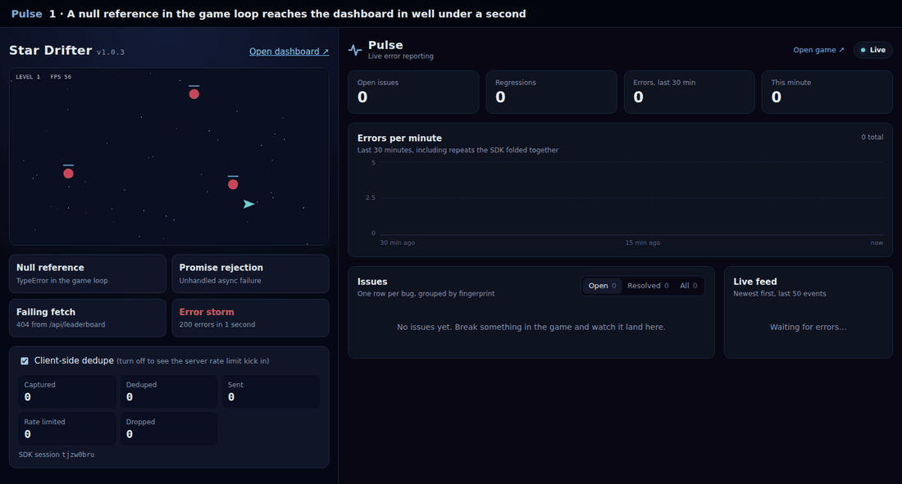
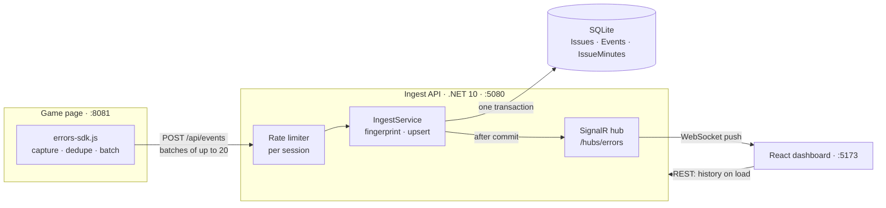
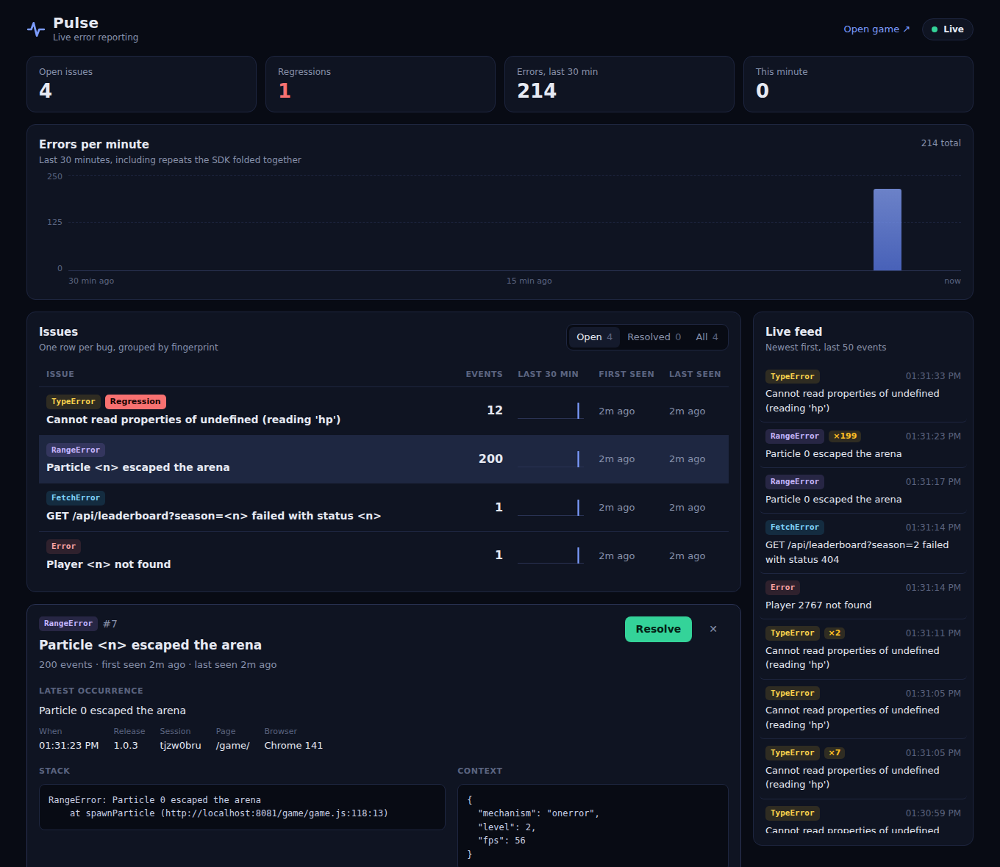

# Pulse — live error reporting demo

A small, working "mini-Sentry". A browser game throws errors, and a live dashboard shows them grouped, counted and charted within a second.

I built it in one night to think real-time error reporting through end to end: capture, ingest, grouping, push and display. It also covers the problems that show up as soon as real traffic arrives: duplicate noise, error storms, runaway clients and bugs that come back after a fix.



## Run it

```bash
docker compose up --build
```

| | URL | |
|---|---|---|
| Game | http://localhost:8081 | throws errors on purpose |
| Dashboard | http://localhost:5173 | watches them arrive |
| API | http://localhost:5080 | ingest, REST and the SignalR hub |

Put the game and the dashboard side by side and start clicking.

<details>
<summary>Without Docker (for development)</summary>

Needs the .NET 10 SDK, Node 22 and Python 3 (or any static file server).

```bash
# 1. API on :5080 (creates pulse.db on first run)
cd api/Pulse.Api && dotnet run

# 2. Dashboard on :5173 (Vite proxies /api and /hubs to :5080)
cd dashboard && npm install && npm run dev

# 3. Game on :8081. Serve the repo root so /game and /sdk are both reachable
python3 -m http.server 8081        # then open http://localhost:8081/game/
```

</details>

## The two-minute demo

1. **Live.** Click **Null reference**. The `TypeError` shows up on the dashboard in well under a second.
2. **Grouping.** Click it 10 more times. The dashboard still shows **one** issue, now with count **11**, not 11 rows.
3. **Noise control.** Click **Error storm** (200 errors in 1 second). The issue count goes to exactly 200, but the live feed gains only two entries: the first error, then one event carrying `×199`.
4. **Rate limiting.** Untick *Client-side dedupe* and fire the storm again. This time the server answers part of it with `429 Too Many Requests`, and the game's *Rate limited* counter shows how many events were turned away.
5. **Regressions.** Open the null-reference issue and click **Resolve**, then trigger it again. It jumps back to *Open* with a **Regression** badge.

## How it works



1. **Capture** ([`sdk/errors-sdk.js`](sdk/errors-sdk.js), under 200 lines, no dependencies). The SDK listens for `error` and `unhandledrejection`, and wraps `fetch` so network failures and non-2xx responses are reported too. Each event carries the release, a session id, the page and game context (`level`, `fps`).
   - Events are queued and sent every 2 s or as soon as 20 are waiting. The first error after a quiet spell goes out at once, so the dashboard feels instant.
   - On `pagehide`, whatever is left goes out with `navigator.sendBeacon`, which survives the page unloading.
2. **Ingest** ([`Program.cs`](api/Pulse.Api/Program.cs), [`IngestService.cs`](api/Pulse.Api/IngestService.cs)). `POST /api/events` accepts up to 50 events and returns `202`. Inside one transaction, each event is fingerprinted, upserted into its issue, counted in its minute and stored.
3. **Group** ([`Fingerprinter.cs`](api/Pulse.Api/Fingerprinter.cs)). This decides which errors are the same bug. It's covered in detail below.
4. **Push** ([`ErrorsHub.cs`](api/Pulse.Api/ErrorsHub.cs)). Once the transaction commits, the API broadcasts `issueCreated` or `issueUpdated` and `eventReceived` to every connected dashboard.
5. **Display** ([`dashboard/`](dashboard/src)). The dashboard loads history once over REST, then applies pushes as they arrive; there is no polling. It has:
   - KPI tiles, a per-minute spike chart and a live feed
   - an issues table with 30-minute sparklines
   - an issue detail with the stack, context and recent events

   There is no chart library: the bars are divs and the sparklines are a few SVG rectangles.

   

### Grouping: the fingerprint

`fingerprint = SHA-256(type + normalised message + top 3 stack frames)`

- **Message normalisation.** URLs, GUIDs and numbers become placeholders, so `Player 4821 not found` and `Player 77 not found` land in one issue titled `Player <n> not found`.
- **Frames.** Each frame is reduced to `function@file`, dropping line and column numbers and the host.
  - A release that shifts code, or the same game served from another domain, doesn't split one bug into many issues.
  - Chrome stacks and Firefox/Safari stacks parse to the same frames.

### Production touches

| Concern | What's built |
|---|---|
| Duplicate noise | **SDK dedupe.** The same error again within 5 s is counted, not sent. When the window closes, one event goes out with `count: N`. The server adds `N` to the issue, so totals stay exact while the network stays quiet. |
| Runaway clients | **`AddRateLimiter` token bucket per session.** A burst of 5 requests, refilled at one every 2 s. That is exactly the SDK's flush rate, so a well-behaved client never hits the limit. Rejected requests get a `429`, and the SDK doesn't retry into the limit. |
| Concurrent writes | **One-statement upsert.** The issue upsert is a single `INSERT … ON CONFLICT DO UPDATE SET Count = Count + excluded.Count … RETURNING` statement, so two batches can't both read 5 and both write 6. |
| Regressions | `PATCH /api/issues/{id}` resolves an issue. The next event on it reopens the issue and flags it with `isRegression`. |
| Storage growth | Only the latest 100 events per issue are kept. Counts and per-minute stats are stored separately, so trimming never loses totals. |
| Spike chart | `IssueMinutes` keeps per-issue, per-minute counts for the chart and the sparklines. Counting rows in the capped `Events` table would undercount exactly the spikes worth seeing. |
| Consistency | Pushes go out only after commit, so a dashboard never shows data that could still roll back. On connect and reconnect, the dashboard reloads history and keeps whichever copy of an issue is newer. |
| Cross-origin ingest | The game runs on its own origin, like a customer's site would, so the API allows CORS. The SDK posts as `text/plain`: this keeps every batch a "simple" request with no preflight, and `sendBeacon` can't post anything else cross-origin. |
| Oversized payloads | Batches are capped at 50 events and bodies at 256 KB (`413` beyond that). Every field is clipped before storage. |

## API

| Method | Route | Purpose |
|---|---|---|
| POST | `/api/events?sessionId=…` | Batch ingest: a JSON array of up to 50 events. Returns `202`. The body may be sent as `application/json` or `text/plain`. |
| GET | `/api/issues?status=open\|resolved\|all` | Grouped issues, most recently seen first, each with a per-minute `trend` for the last 30 minutes |
| GET | `/api/issues/{id}/events?limit=20` | Latest occurrences of one issue |
| PATCH | `/api/issues/{id}` | `{"status": "resolved"}` or `{"status": "open"}` |
| GET | `/api/events?limit=50` | Latest events across all issues (fills the live feed on load) |
| GET | `/api/stats/per-minute` | Event counts per minute, last 30 minutes |
| WS | `/hubs/errors` | SignalR hub pushing `eventReceived`, `issueCreated` and `issueUpdated` |

An event as the SDK sends it:

```json
{
  "type": "TypeError",
  "message": "Cannot read properties of undefined (reading 'hp')",
  "stack": "TypeError: Cannot read properties of undefined (reading 'hp')\n    at applyDamage (http://localhost:8081/game/game.js:33:3)\n    at tick (http://localhost:8081/game/game.js:52:5)",
  "url": "/game/",
  "release": "1.0.3",
  "sessionId": "a1b2c3",
  "timestamp": "2026-09-30T14:02:11Z",
  "context": { "mechanism": "onerror", "level": 3, "fps": 57 },
  "count": 1
}
```

You can try it without the game:

```bash
curl -X POST "localhost:5080/api/events?sessionId=curl" -H "Content-Type: application/json" \
  -d '[{"type":"Error","message":"Player 4821 not found","stack":"at loadProfile (game.js:42:13)"}]'
curl localhost:5080/api/issues
```

## Data model

| Table | Key fields | Notes |
|---|---|---|
| `Issues` | Id, Fingerprint (unique), Title, Type, FirstSeen, LastSeen, Count, Status (Open/Resolved), IsRegression | One row per distinct bug, upserted atomically on each event |
| `Events` | Id, IssueId, Timestamp, Message, Stack, Url, UserAgent, Release, SessionId, Context (JSON), RepeatCount | Every occurrence, capped at the latest 100 per issue |
| `IssueMinutes` | IssueId + Minute (key), Count | Per-minute rollup behind the spike chart and sparklines |

## Tests

```bash
cd api && dotnet test
```

The suite has 28 xUnit tests.
- **Fingerprinter:** normalisation, Chrome and Firefox stacks, line numbers moving between releases, and the top-3-frames rule.
- **End-to-end API**, each test against a throwaway SQLite database: grouping, repeat counts, `text/plain` beacons, validation, the 100-event cap, resolve → regression, the rate limiter, and a real SignalR client receiving the pushes.

## Trade-offs, and what I'd do at production scale

| Topic | What's built | At production scale |
|---|---|---|
| Grouping | Hash of type, normalised message and top 3 frames | Source maps to un-minify stacks; custom fingerprint rules per project |
| Volume spikes | Client dedupe plus a per-session rate limit | Sampling above a threshold (e.g. keep 10%); a queue (Redis Streams, Kafka) between ingest and storage, so `202` truly means "queued" |
| Real-time push | SignalR broadcast of every event | Throttle to one update per issue per second; Azure SignalR Service or a Redis backplane to scale out |
| Storage | SQLite, last 100 events per issue | Postgres or ClickHouse; a retention job (e.g. 30 days) |
| Rate-limit key | Session id from the SDK | A per-project key plus client IP, since a session id is chosen by the client and easy to rotate |
| Privacy | No personal data captured | Scrub emails, tokens and player IDs in the SDK before sending |
| Alerting | Dashboard only | Alert on a new issue, a regression, or a spike above baseline, to Slack or email |
| Build or buy | Built to understand it | For a small team, self-hosted Sentry or a managed tool is usually cheaper than building. I'd build only the game-specific parts. |

Deliberately out of scope: auth, source maps, multi-tenant projects, alert emails, retention jobs and horizontal scaling. The schema is created with `EnsureCreated()` rather than migrations.

## Project layout

```
api/
  Pulse.Api/            .NET 10 minimal API
    Program.cs          endpoints, CORS, rate limiter, SignalR
    IngestService.cs    batch → fingerprint → atomic upsert → push
    Fingerprinter.cs    what counts as "the same bug"
    PulseDb.cs          EF Core model: Issues, Events, IssueMinutes
    Contracts.cs        DTOs and query helpers
    ErrorsHub.cs        SignalR hub
  Pulse.Api.Tests/      xUnit: fingerprinting and end-to-end API tests
sdk/errors-sdk.js       the browser SDK
game/                   canvas demo game with four ways to break it
dashboard/              React + Vite + TypeScript dashboard
docker/game.conf        nginx config for the game container
docker-compose.yml      api + dashboard + game
```
